# Modelo de dados do VitrineIC — 3FN

Este é o modelo em produção, não uma proposta. O esquema vive em
`server/db/migrations/001_schema.sql` e é aplicado por `server/db/migrate.ts`;
o domínio que ele atende está em `src/types/index.ts`, `server/schemas.ts` e
`src/data/`.

A versão anterior do sistema guardava cada entidade como um JSON numa coluna
`data TEXT` do SQLite, e todo filtro era feito em memória depois de ler a tabela
inteira. Este documento registra a abertura daqueles JSONs em tabelas
relacionais em 3FN e as decisões tomadas no caminho. O levantamento do custo das
consultas antes e depois está em `docs/mapa-de-queries.md`.

## Necessidades do sistema

**Identidade e acesso** — três papéis (estudante, solicitante, curadoria) numa
mesma tabela de conta; senha em hash scrypt; sessão por cookie com expiração;
token de recuperação e de confirmação de e-mail com validade e invalidação por
troca de credencial.

**Perfil do estudante** — vínculo com unidade e curso da UFAL; competências com
proficiência declarada; idiomas com proficiência; tópicos de interesse;
portfólio de projetos com pilha de tecnologias; anexos privados (comprovantes
e portfólio); selo "em projeto"; estado do onboarding.

**Perfil do solicitante** — organização, tipo (empresa, ONG, órgão público,
professor), cidade, site, descrição e pessoa responsável.

**Demanda** — publicada pelo solicitante, triada pela curadoria, com protocolo,
área, escopo, prazo, competências exigidas e trilha de mudanças de status.

**Match** — interesse único entre estudante e demanda, nascido de candidatura,
convite ou sugestão; resposta de cada lado; contato liberado só com aceite
duplo; motivo de recusa visível ao solicitante e à curadoria, nunca ao
estudante.

**Comunicação** — mensagens dentro de um interesse já liberado e notificações
por conta, com leitura.

**Catálogos** — unidades e cursos, competências com categoria e apelidos
(o match compara texto canonizado), idiomas, áreas, escopos, tópicos e as duas
escalas de proficiência.

**Impacto** — só o que não é derivável: depoimentos e metas. Os indicadores
continuam calculados em tempo de consulta sobre as tabelas abaixo.

## Decisões de normalização

1. **`estudante` não guarda `unidade`.** O curso determina a unidade, então
   manter os dois no estudante seria dependência transitiva. A unidade vem por
   `curso → unidade_academica`.
2. **`skills[]` + `skillLevels{}` viraram `estudante_competencia`.** Eram um
   grupo repetitivo mais um mapa paralelo que podiam divergir.
3. **Solicitante ganha chave substituta.** Antes a PK era o nome da
   organização e as demandas referenciavam esse texto: renomear quebrava tudo.
4. **E-mail e nome da pessoa vivem só em `conta`.** Estavam duplicados em
   `Student.email` e `Company.contactEmail`/`contactName`.
5. **`initials` saiu** — é derivado do nome.
6. **Notificação não guarda mais o título da demanda nem o nome do remetente.**
   Dependiam de `demanda` e de `conta`, não da notificação.
7. **Mensagem foi separada de notificação.** Antes as duas moravam na mesma
   tabela, distinguidas por `type`. O aviso de sistema sem demanda associada
   guarda o próprio `assunto`; com demanda, o título sai por junção.
8. **Duas escalas de proficiência.** O nível 4 é "Especialista" em competência
   e "Fluente" em idioma: são tabelas distintas.
9. **`status` continua na demanda e no interesse** como estado corrente, com o
   histórico em tabela própria. É dependência funcional da chave, não redundância.

## Diagrama

Gerado a partir de `server/db/migrations/001_schema.sql`, para não divergir do
banco, e na mesma ordem das oito seções daquele arquivo: identidade, vocabulário,
estudante, solicitante, demanda, match, comunicação, impacto. O vocabulário vem
na segunda posição porque o PostgreSQL exige a tabela referenciada criada antes
da `REFERENCES`; na leitura do domínio ele é pano de fundo, não o começo.

Os identificadores expostos pelo contrato HTTP são `text`, porque são semânticos
e aparecem na tela — o id da demanda é o próprio protocolo (`VIC-2026-0046`). Os
catálogos e as tabelas internas usam `uuid`.

```mermaid
erDiagram
    %% ── 1. Identidade e acesso ──
    conta {
        text id PK
        text email UK
        text nome
        text papel "student | requester | curator"
        text senha_hash
        integer versao_credencial
        timestamptz email_confirmado_em
        timestamptz criada_em
    }
    sessao {
        text token_hash PK
        text conta_id FK
        timestamptz expira_em
    }
    token_conta {
        text token_hash PK
        text conta_id FK "UK com proposito"
        text proposito "reset_password | verify_email"
        integer versao_credencial
        timestamptz criado_em
        timestamptz expira_em
    }

    %% ── 2. Vocabulário controlado ──
    unidade_academica {
        text codigo PK
        text nome UK
    }
    curso {
        uuid id PK
        text unidade_codigo FK "UK com nome"
        text nome "UK com unidade_codigo"
    }
    categoria_competencia {
        uuid id PK
        text nome UK
    }
    competencia {
        uuid id PK
        text nome_canonico UK
        uuid categoria_id FK
        boolean fora_do_catalogo
    }
    competencia_alias {
        uuid id PK
        uuid competencia_id FK
        text alias UK
    }
    nivel_competencia {
        smallint nivel PK "1..4"
        text rotulo UK
    }
    idioma {
        uuid id PK
        text nome UK
    }
    nivel_idioma {
        smallint nivel PK "1..4"
        text rotulo UK
    }
    topico_interesse {
        uuid id PK
        text nome UK
    }
    area {
        uuid id PK
        text nome UK
    }
    escopo_demanda {
        uuid id PK
        text rotulo UK
        integer meses_max
    }
    tipo_solicitante {
        text codigo PK "empresa | ong | orgao_publico | professor"
        text rotulo
    }

    %% ── 3. Perfil do estudante ──
    estudante {
        text id PK
        text conta_id FK,UK
        uuid curso_id FK
        text matricula
        text semestre
        numeric cra
        text bio
        text github
        text linkedin
        text site
        text lattes
        text certificados
        text disponibilidade
        boolean em_projeto
        text foto
        date onboarding_em
        boolean onboarding_pulado
    }
    estudante_competencia {
        text estudante_id PK,FK
        uuid competencia_id PK,FK
        smallint nivel FK
    }
    estudante_idioma {
        text estudante_id PK,FK
        uuid idioma_id PK,FK
        smallint nivel FK
    }
    estudante_topico {
        text estudante_id PK,FK
        uuid topico_id PK,FK
    }
    projeto_estudante {
        text id PK
        text estudante_id FK
        text titulo
        text descricao
        text situacao "ideation | coding | review | done"
        char ano
        uuid area_id FK
        text link
        timestamptz criado_em
    }
    projeto_capa {
        text projeto_id PK,FK
        text mime "image/png | image/jpeg | image/webp"
        bytea conteudo
        int tamanho_bytes
        timestamptz enviada_em
    }
    projeto_competencia {
        text projeto_id PK,FK
        uuid competencia_id PK,FK
    }
    anexo_estudante {
        uuid id PK
        text estudante_id FK
        text nome
        text categoria "tech | language | portfolio"
        text mime
        bytea conteudo
        integer tamanho_bytes
        timestamptz enviado_em
    }

    %% ── 4. Solicitante ──
    solicitante {
        text id PK
        text conta_id FK,UK
        text nome UK
        text tipo_codigo FK
        text rotulo_exibicao
        text cidade
        char desde
        text site
        text descricao
    }

    %% ── 5. Demanda ──
    demanda {
        text id PK
        text solicitante_id FK
        text titulo
        text descricao
        uuid area_id FK
        uuid escopo_id FK
        date prazo
        text status "nova | em_analise | aprovada | rejeitada | contato_liberado"
        text prioridade "alta | normal | baixa"
        text publico_alvo
        text nivel_academico
        text tamanho_equipe
        text orcamento
        text observacoes
        timestamptz enviada_em
    }
    demanda_competencia {
        text demanda_id PK,FK
        uuid competencia_id PK,FK
    }
    demanda_historico_status {
        uuid id PK
        text demanda_id FK
        text status
        text alterado_por_conta_id FK
        text observacao
        timestamptz alterado_em
    }

    %% ── 6. Match ──
    interesse {
        text id PK
        text demanda_id FK
        text estudante_id FK
        text origem "candidatura | convite | sugestao"
        text justificativa
        text status "aguardando_estudante | aguardando_solicitante | contato_liberado | recusado_estudante | recusado_solicitante"
        text criado_por_conta_id FK
        timestamptz criado_em
    }
    interesse_resposta {
        text interesse_id PK,FK
        text lado PK "estudante | solicitante"
        boolean aceito
        text motivo_recusa
        timestamptz respondido_em
    }

    %% ── 7. Comunicação ──
    mensagem {
        uuid id PK
        text interesse_id FK
        text remetente_conta_id FK
        text conteudo
        timestamptz enviada_em
    }
    notificacao {
        uuid id PK
        text destinatario_conta_id FK
        text tipo "SISTEMA | MENSAGEM"
        text demanda_id FK
        text interesse_id FK
        uuid mensagem_id FK
        text assunto
        text conteudo
        timestamptz criada_em
        timestamptz lida_em
    }

    %% ── 8. Impacto (só o não derivável) ──
    depoimento {
        uuid id PK
        text texto
        text autor
        text papel_autor
        text periodo
    }
    meta_indicador {
        text chave PK
        text rotulo
        numeric valor_meta
        text periodo
    }

    %% ── Relações ──
    %% 1. Identidade
    conta                 ||--o{ sessao                   : ""
    conta                 ||--o{ token_conta              : ""
    conta                 ||--o| estudante                : ""
    conta                 ||--o| solicitante              : ""

    %% 2. Catálogos
    unidade_academica     ||--o{ curso                    : "unidade"
    categoria_competencia |o--o{ competencia              : "categoria"
    competencia           ||--o{ competencia_alias        : ""

    %% 3. Estudante
    curso                 |o--o{ estudante                : ""
    estudante             ||--o{ estudante_competencia    : ""
    competencia           ||--o{ estudante_competencia    : ""
    nivel_competencia     |o--o{ estudante_competencia    : "nivel"
    estudante             ||--o{ estudante_idioma         : ""
    idioma                ||--o{ estudante_idioma         : ""
    nivel_idioma          ||--o{ estudante_idioma         : "nivel"
    estudante             ||--o{ estudante_topico         : ""
    topico_interesse      ||--o{ estudante_topico         : "topico"
    estudante             ||--o{ projeto_estudante        : ""
    area                  |o--o{ projeto_estudante        : ""
    projeto_estudante     |o--o| projeto_capa              : ""
    projeto_estudante     ||--o{ projeto_competencia      : "projeto"
    competencia           ||--o{ projeto_competencia      : ""
    estudante             ||--o{ anexo_estudante          : ""

    %% 4 e 5. Solicitante e demanda
    tipo_solicitante      ||--o{ solicitante              : "tipo"
    solicitante           ||--o{ demanda                  : ""
    area                  |o--o{ demanda                  : ""
    escopo_demanda        |o--o{ demanda                  : "escopo"
    demanda               ||--o{ demanda_competencia      : ""
    competencia           ||--o{ demanda_competencia      : ""
    demanda               ||--o{ demanda_historico_status : ""
    conta                 |o--o{ demanda_historico_status : "alterado por"

    %% 6. Match
    demanda               ||--o{ interesse                : ""
    estudante             ||--o{ interesse                : ""
    conta                 |o--o{ interesse                : "criado por"
    interesse             ||--o{ interesse_resposta       : ""

    %% 7. Comunicação
    interesse             ||--o{ mensagem                 : ""
    conta                 ||--o{ mensagem                 : "remetente"
    conta                 ||--o{ notificacao              : "destinatario"
    demanda               |o--o{ notificacao              : ""
    interesse             |o--o{ notificacao              : ""
    mensagem              |o--o{ notificacao              : ""
```

## Restrições que o diagrama não expressa

- `interesse`: índice único parcial em `(demanda_id, estudante_id)` enquanto o
  status não for `recusado_estudante` nem `recusado_solicitante` — recusa
  permite nova tentativa.
- `estudante.conta_id` e `solicitante.conta_id` são `UNIQUE`; o papel da conta
  tem de combinar com a tabela de perfil.
- `curso`: `UNIQUE (unidade_codigo, nome)`.
- `token_conta`: `UNIQUE (conta_id, proposito)` — um link vivo por finalidade.
- `demanda.status` só vai a `contato_liberado` por consequência de um
  interesse liberado.
- `interesse.status` é derivável de `interesse_resposta`; mantê-lo exige
  gatilho ou escrita na mesma transação.
- Perfil sem nenhuma competência não aparece na vitrine (`isProfileVisible`):
  é regra de consulta, não restrição de tabela.
- Indicadores do painel de impacto são calculados por consulta. Não crie
  colunas para eles.
- A canonização de nomes de competência acontece na aplicação, não no banco:
  `server/schemas.ts` passa toda lista de skills por `canonicalSkill`
  (`src/data/skills.ts`) antes de validar, então "ReactJS" e "react.js" chegam
  como "React". A tabela `competencia_alias` é populada por
  `server/db/sync-catalog.ts` e alimenta a busca do catálogo na interface;
  nenhuma consulta de match a lê. Nome fora do catálogo entra por
  `garantirCompetencia`, em `server/db/mutations.ts`, marcado
  `fora_do_catalogo = true`.
- `estudante_competencia.nivel` é coletado no onboarding e devolvido pela API
  como `skillLevels`, mas `scoreStudent` (`src/lib/match.ts`) ainda não o usa:
  o score é cobertura pura das competências exigidas. A demanda também não
  declara nível exigido — `demanda_competencia` não tem essa coluna. Dar peso
  ao nível depende dessa decisão de produto, registrada em
  `docs/ata-reuniao-final.md`.
